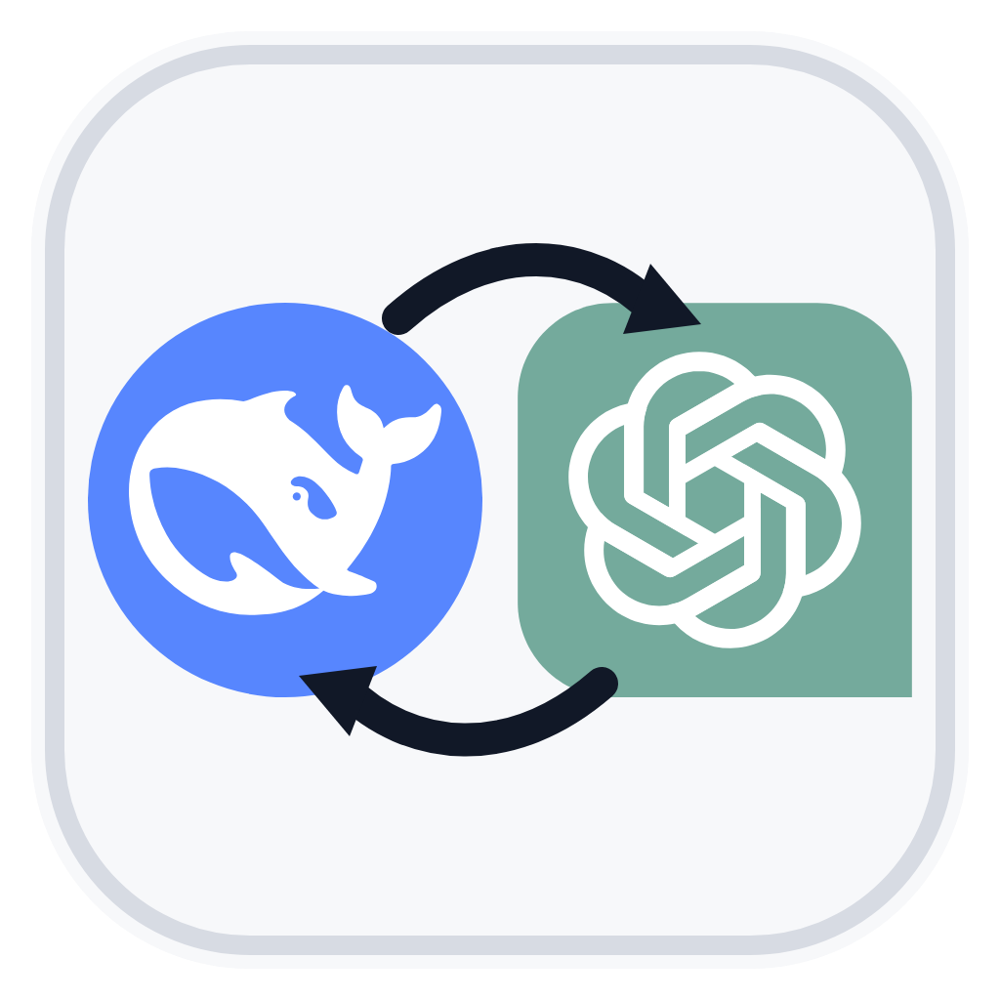

<p align="center">
  
</p>

<h1 align="center">Codex Switch</h1>

<p align="center">Switch Codex between model providers.</p>

<p align="center">
  <a href="README.md">中文</a> · <a href="README.en.md">English</a>
</p>

---

Codex Switch is a provider and model switcher for the Codex desktop app. The current release supports **GPT (ChatGPT login)** and **DeepSeek API**. More providers will follow the same structure.

It is not a general API proxy. It does not forward requests. It only rewrites Codex's local configuration to the provider you choose and keeps a rollback copy.

## Current support

| Provider | Status | Notes |
|---|---|---|
| GPT / ChatGPT login | Supported | Uses Codex's built-in `openai` provider |
| DeepSeek API | Supported | Writes the DeepSeek provider, model, and model catalog |
| MiniMax | Planned | Requires a Responses-compatible endpoint |
| Custom provider | Planned | Enter your own base URL, model, and key |

> Codex currently supports `wire_api = "responses"` only. If a provider offers Chat Completions only, you need a Responses-compatible gateway in front of it.

## Requirements

**No Python, Node.js, or Docker required.**

| | macOS | Windows |
|---|---|---|
| OS | macOS 13 Ventura or newer | Windows 10 / 11 (64-bit) |
| Runtime | Built in, no extra dependency | Built-in PowerShell 5.1 |
| Codex | Desktop app installed and signed in with ChatGPT at least once | Same |
| Client version | Recent build recommended; model catalog requires 0.144.0+ | Same |
| API key | Your own DeepSeek API key | Same |
| Network | Access to `api.deepseek.com`; the switch itself is offline | Same |
| Disk | Writes to `~/.codex` and `~/.codex/deepseek-switch-backups` | Writes to `%USERPROFILE%\.codex` |
| Permissions | App is not notarized: right-click → Open on first launch | You may need to unblock the downloaded folder |

Your key must be a single line, without quotes or extra spaces. It usually starts with `sk-`.

## Download

- macOS: [Codex-Switch-mac.zip](Codex-Switch-mac.zip)
- Windows: [Codex-Switch-windows.zip](Codex-Switch-windows.zip)

## macOS: two options

### Option A: one-click app (recommended)

1. Unzip and open `mac/方案A-一键App/Codex Switch.app`.
2. On first launch, paste your DeepSeek key and click Save.
3. Click **Switch to DeepSeek**.
4. Quit Codex completely with `⌘Q`, then reopen it.
5. Select **DeepSeek-Flash** in the model list.

After that, use the menu bar icon, or press `⌘1` / `⌘2`. If something goes wrong, use **Restore last backup**.

If macOS says the developer cannot be verified: right-click the app → **Open** → **Open** again.

### Option B: command line

1. Open `mac/方案B-命令行/`.
2. Paste your key into the next line of `deepseek/deepseek-key.txt`.
3. Quit Codex completely.
4. Double-click `一键安装.command`.
5. Reopen Codex and select **DeepSeek-Flash**.

See [mac/使用说明.md](mac/使用说明.md) for details (Chinese).

## Windows

1. Unzip and open `windows/`.
2. Paste your key into the next line of `deepseek\deepseek-key.txt` using Notepad.
3. Double-click `环境检查.bat` to check Windows, PowerShell, Codex config, and the key.
4. Quit Codex / ChatGPT completely, including the tray icon.
5. Double-click `一键安装.bat`.
6. Reopen Codex and select **DeepSeek-Flash**.

You will get three desktop shortcuts: Switch to DeepSeek, Switch to GPT, and Toggle model.

If Windows marks the files as downloaded from the internet: right-click the folder → Properties → Unblock.

See [windows/使用说明.md](windows/使用说明.md) for details (Chinese).

## After the first switch

1. Codex has been fully quit and reopened.
2. **DeepSeek-Flash** appears in the model list.
3. Sending “Reply with OK only” works.
4. Switching back to GPT restores your previous GPT model name.
5. The status screen reports the expected channel.

## What it changes

It only edits Codex's user-level `config.toml`:

```toml
model = "deepseek-flash"
model_provider = "deepseek"
model_catalog_json = "/Users/you/.codex/models.json"
```

plus a provider block:

```toml
[model_providers.deepseek]
name = "DeepSeek"
base_url = "https://api.deepseek.com/"
wire_api = "responses"
experimental_bearer_token = "your key"
```

Switching back to GPT removes those lines and restores your previous GPT model name.

It also installs the provider's model catalog, and backs up the previous config to `~/.codex/deepseek-switch-backups/` before every change. It does not touch `auth.json`, session history, or databases.

## Security

- No real API keys are stored in this repository.
- The switcher does not upload your key. It writes local configuration only.
- Codex itself must read the key to call the API, so the provider block in `config.toml` contains it in plain text.
- Do not share `config.toml`, `auth.json`, or a package with your key filled in.

## FAQ

**DeepSeek does not appear in the model list**

Make sure Codex was fully quit and reopened; check that the active provider is `deepseek`; confirm `~/.codex/models.json` exists; update Codex if it is too old.

**DeepSeek returns 401**

The key is wrong, out of quota, or contains spaces/quotes. Enter it again and switch once more.

**macOS blocks the app**

Right-click the app → Open. It is signed ad hoc, not notarized, so macOS asks once.

**Nothing happens on Windows**

Right-click the folder → Properties → Unblock. Or run `环境检查.bat` first to see which check fails.

**The switch has no effect**

Quit Codex completely and reopen it. On Windows, also quit the tray process.

**DeepSeek cannot connect**

If you use a global proxy, check whether `api.deepseek.com` is being proxied. Direct access is usually more reliable in mainland China.

## Multi-provider roadmap

The next version will replace hard-coded DeepSeek logic with provider manifests:

```text
providers/
├── deepseek.toml
├── minimax.toml
└── custom.toml

catalogs/
├── deepseek.json
└── minimax.json
```

Each provider declares its `base_url`, `wire_api`, model, catalog, and key field. Both the macOS app and the Windows script will read the same manifests instead of branching per provider.

Local state will move to:

```text
~/.codex/codex-switch/
├── state.json
├── keys/<provider>
├── catalogs/<provider>.json
└── backups/
```

## Repository layout

```text
mac/
├── 使用说明.md
├── 方案A-一键App/
└── 方案B-命令行/
windows/
├── 使用说明.md
├── 一键安装.bat
├── 一键切换.bat
├── 环境检查.bat
└── CodexSwitch.ps1
Codex-GPT-DeepSeek-切换指南.md
README.md
README.en.md
assets/icon.png
```

## Compatibility and status

- The macOS app targets macOS 13+ and has been tested on macOS 26.
- The Windows package has been used long-term on a real Windows machine; first-run switching worked.
- Provider model names, API compatibility, and request limits may change. Re-test before each release.

## License

No open-source license is specified yet. Contact the author before commercial use, redistribution, or publishing a modified version.
